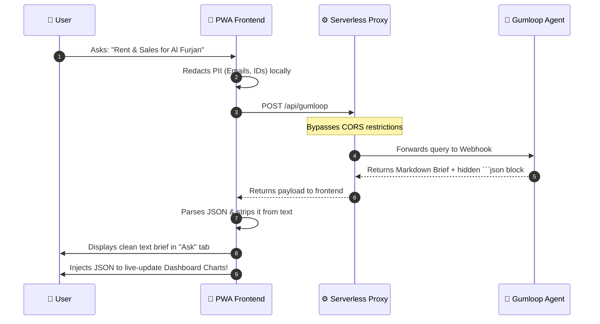

# 🏙️ Dubai Market Desk
*An AI-Powered Progressive Web App for Dubai Real Estate Intelligence*

Dubai Market Desk is like having a super-smart, private real estate advisor in your pocket

### 🚀 Lighthouse Performance

  <b>Built for Individual Investors • Property Consultants • Serious Buyers</b> 
  <i>Anchored in closed Dubai Land Department (DLD) sales and registered Ejari contracts.</i>

---

## 📖 Overview

**Dubai Market Desk** is a secure, offline-first Progressive Web App (PWA) acting as a specialized terminal for researching the Dubai real estate market. 

It solves the problem of inflated property portal asking prices by combining a **statically pinned offline snapshot** of verified DLD/Ejari market data with a **dynamic "Ask" interface** powered by an autonomous AI Agent via a Gumloop webhook. When the AI fetches real-time data for un-cached communities, the dashboard charts seamlessly update on the fly.

---

## ✨ Key Features & Functions

| 📊 **Market Dashboard** | 🤖 **Live AI Agents** |
| :--- | :--- |
| **City Snapshot:** Instant, offline-ready KPIs for home sales, values, and rental yields.  **Dynamic Injection:** Charts and cards automatically rebuild themselves when live JSON data is fetched by the AI.  **Granular Charts:** Tap-to-inspect Canvas charts for price-per-sqft, off-plan vs. ready, and bedroom ticket medians. | **Multi-Persona:** Route queries to a *Market Analyst*, *Compliance Reviewer*, or *Investment Advisor*.  **Voice Input:** Dictate research queries natively using browser speech recognition.  **Smart Context:** AI automatically knows your currently viewed community and the baseline snapshot dates. |

| 🛡️ **Enterprise Security** | ⚡ **PWA & Offline** |
| :--- | :--- |
| **PII Redaction:** Emails, phones, Emirates IDs, and passports are automatically masked locally before hitting the API.  **Audit Logging:** Immutable SHA-256 hash-chained logs of all queries and actions.  **Local Encryption:** AES-GCM encryption on local storage with automatic 30-day data deletion. | **Installable:** Runs securely in-browser or installs natively to mobile/desktop home screens.  **Zero-State Handlers:** Graceful fallbacks when a community isn't cached, prompting a live AI fetch.  **Export & Share:** Print-ready PDF rendering and native mobile Share Sheet integration. |

---

## 🏗️ The "Hybrid" Data Architecture

Modern browsers block cross-origin requests (CORS) from client-side JavaScript to third-party webhooks. Furthermore, static dashboards cannot normally display live AI text. 

This app solves both via a **Proxy-First + JSON Payload** architecture:

---

## 🧰 Tech Stack

* **Frontend:** Vanilla HTML5, CSS3, JavaScript (ES6+). *Zero heavy frontend frameworks.*
* **Charts:** Dependency-free, custom-built Canvas API bar charts (`js/charts.js`).
* **Backend / API:** Vercel/Netlify Serverless Functions (`/api/gumloop`) for CORS bridging.
* **AI Engine:** Gumloop Webhooks connected to Claude/OpenAI models.
* **Security:** Web Crypto API (`js/security.js`) for AES-GCM local storage and SHA-256 auditing.

---

## 🔒 Compliance & Data Residency

This application provides live indicators for **UAE PDPL compliance**. Because Gumloop's processing location is not strictly localized to the UAE, the app explicitly warns users regarding data residency and actively forces local redaction of Personally Identifiable Information (PII) before any network request leaves the device.

---

