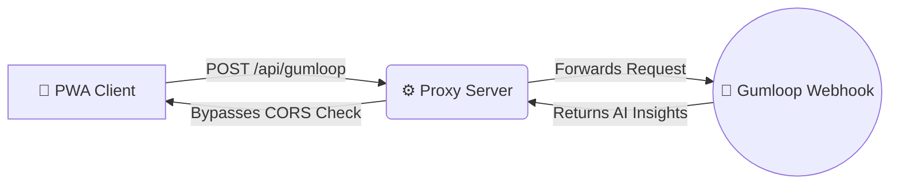

# 🏙️ Dubai Market Desk (PWA)

[](LICENSE)
[](#)
[](#)

A Progressive Web App (PWA) acting as a specialized terminal for researching the Dubai real estate market. It combines a statically pinned snapshot of third-party market data with a dynamic "Ask" interface powered by an autonomous AI Agent via a Gumloop webhook.

---

## ✨ Key Features & Functions

### 📊 Core Metrics (City Snapshot)
The main dashboard visualizes real estate facts through interactive, tap-to-inspect charts based on DLD/Ejari data up to Q3 2026:
*   **Headline KPIs:** Track September home sales volume, total sales value, median price per sq ft, and 12-month apartment rent growth.
*   **Price Per Sq Ft:** Side-by-side comparison of different index methodologies (Projectory, PIX, Prop971).
*   **Off-Plan vs. Ready:** Breakdowns by count and value, including community-specific drops (e.g., Azizi Venice).
*   **Rental Yields & Costs:** Track rent changes across specific communities (DIP Second, Liwan, Downtown Dubai) and apartment sizes (Studio to 3-Bed).

### 🤖 AI Agent Integration
*   **Multi-Agent Support:** Engage specialized AI personas including a *Market Analyst*, *Compliance Reviewer*, and *Investment Advisor*.
*   **"Request Snapshot" Trigger:** A dedicated button sends a standard `{"message":"City snapshot"}` payload directly to the Gumloop webhook.
*   **Voice Input:** Dictate queries directly into the Ask interface using native browser speech recognition.

### 🛡️ Security, Export & Compliance
*   **Data Protection:** Automatic redaction of PII (emails, phone numbers, Emirates IDs, IBANs, passports) before payloads hit the webhook.
*   **Audit Logging:** Hash-chained (SHA-256) action logs with JSON/CSV export capabilities.
*   **Export/Share:** Generate PDF reports via print stylesheets or use the native mobile Share Sheet.
*   **Compliance Dashboard:** Live indicators for UAE PDPL compliance, data residency warnings, and localized data erasure tools (AES-GCM encryption on local storage; auto-deleted after 30 days).

---

## 🏗️ System Architecture & CORS Handling

Because modern browsers block cross-origin requests (CORS) from client-side JavaScript to third-party webhooks, this app implements a proxy-first architecture. 

### Request Flow


* **Local Development:** Uses `dev-server.js` to run a local Express-style server that proxies requests.


* **Vercel Deployment:** Utilizes a `vercel.json` rewrite to route `/api/gumloop` directly to the webhook URL.


* **Netlify Deployment:** Utilizes a `netlify.toml` status 200 redirect.


* *Note: GitHub Pages does not support proxying. Deploy via Vercel or Netlify for full webhook functionality.*

---

## 📂 Project Structure

A comprehensive modular architecture handling UI, security, PWA caching, and local development:

```text
dubai-re-pwa/
├── app.js                   # Main application initialization
├── dev-server.js            # Local Node.js server for CORS proxying
├── index.html               # Main dashboard UI
├── offline.html             # Fallback UI for offline PWA state
├── styles.css               # CSP-compliant stylesheet (no inline styles)
├── js/                      # Modular application logic
│   ├── api.js               # Webhook fetch and proxy routing
│   ├── audit.js             # SHA-256 hash-chained action logging
│   ├── charts.js            # Chart rendering and tap-to-inspect logic
│   ├── export.js            # PDF generation and native sharing
│   ├── security.js          # PII redaction and AES-GCM encryption
│   ├── snapshot.js          # Hardcoded October 2026 market data
│   ├── ui.js                # DOM manipulation and KPI card rendering
│   └── voice.js             # Browser speech recognition handler
├── .github/workflows/       # GitHub Actions (e.g., pages.yml)
├── docs/ARCHITECTURE.md     # Extended architecture documentation
├── tests/security.test.mjs  # Unit tests for PII and crypto modules
├── vercel.json              # Proxy rewrite rules for Vercel
├── netlify.toml             # Redirect rules for Netlify
├── package.json             # Project dependencies and npm scripts
└── sw.js / manifest.json    # Service worker and web app manifest

```

---

## 🚀 How to Run Locally

1. Download or clone the repository.
2. Open a terminal in the project directory.
3. Install dependencies and start the proxy server:
```bash
npm install
npm start

```


4. Open the provided `localhost:3000` link in your browser. *(Note: If using GitHub Codespaces, wait for the "Open in Browser" prompt).*

---

## ⚠️ Important Caveats

* **Hardcoded Snapshot:** The current charts are built on a static October 2026 snapshot (`js/snapshot.js`). Updating the data requires manual updates to this file; agent text parsing is disabled for UI safety.


* **Public Webhook Endpoint:** Once deployed, your `/api/gumloop` route is public. Consider wrapping the proxy in a serverless function with rate-limiting if abuse is a concern.
* **Unverified Data Notice:** Data represents third-party calculations (PropertyIndex PIX©, Prop971, Projectory). They are not official DLD index releases.

---

*Built with strict Content Security Policy (CSP) enforcement. Service worker caches app shell for offline functionality.*

```

```
